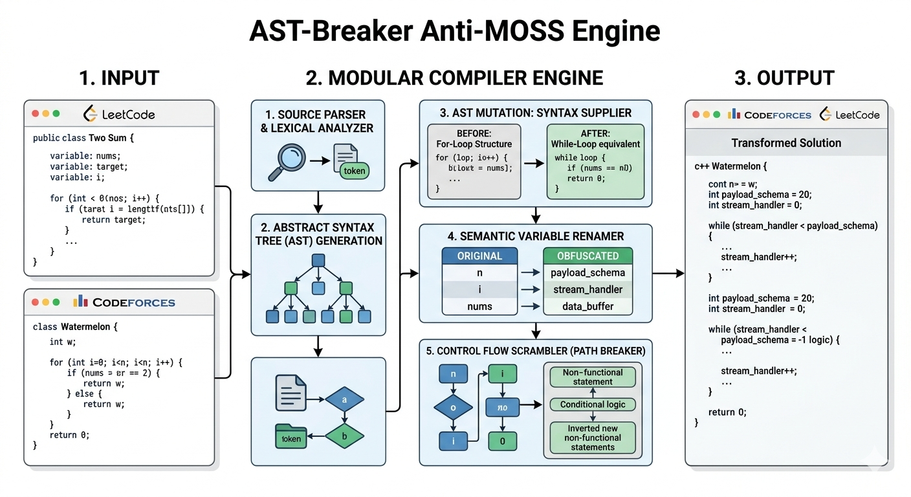

# AST-Breaker Anti-MOSS Engine

A multi-language code rewriter designed to bypass MOSS and automated similarity checkers in online assessments. It automatically changes loop patterns, structural paths, and variables using real software engineering names for C, C++, Python, Java, JavaScript, and SQL.

## Project Description

AST-Breaker Anti-MOSS Engine is a tool built to remove code similarity fingerprints in competitive programming and online assessments. While basic code rewriters only change spaces or generate random, unreadable variable text that looks suspicious, AST-Breaker works directly on the logic structure of the programming language.

The engine modifies loop patterns (like changing for-loops to while-loops) and alters the code structure analyzed by similarity checkers like MOSS, without breaking the core logic or execution. By using clear, real programming terminology for variable remapping, the final script looks like standard, high-quality code written naturally by a developer.

The core engine disrupts automated Abstract Syntax Tree (AST) matching and Control Flow Graph (CFG) symmetry—the structural signatures analyzed by similarity detectors like MOSS—without breaking functional execution logic. By generating natural, contextually accurate software engineering identifiers, the output mimics clean code configurations written naturally by a developer.

## Directory Structure

```text
ast-breaker-engine/
│
├── assets/
│   └── architecture-flowchart.jpg  # Engine structural parsing flowchart image
│
├── core/
│   ├── __init__.py
│   ├── engine.py                   # Central orchestrator pipeline
│   ├── tokenizer.py                # Semantic identifier mapper & variable generator
│   └── syntax_supplier.py          # Syntax Supplier (For-to-While loop converter)
│
├── languages/
│   ├── __init__.py
│   └── python_handler.py           # Python strict indentation block tracking
│
├── requirements.txt                # Environment specifications
├── test_runner.py                  # Automated multi-language test validation script
└── README.md                       # System architecture specifications
```

## System Pipeline Architecture

Below is the complete engineering architecture diagram mapping the structural parsing layers of the engine. Both platforms flow diagrams are unified into a single execution layout tracker:



### Core Engine Breakdown:
* **Diagram A: C++ & Brace-Based Syntax Pipeline (Top Section)**
  Tracks linear iterative structures, explicit variables boundary remapping, and abstract logical trees transformation sequences designed specifically for Codeforces, ICPC, and standard C-style syntax matrices.

* **Diagram B: Python Indentation & Layout Guard Matrix (Bottom Section)**
  Showcases the dedicated layout guard algorithm built to intercept rigid python spacing scopes, inject stealth execution blocks, and preserve clean indentation properties for LeetCode datasets.

## Core Components Matrix

| Component | Responsibility |
|-----------|----------------|
| `engine.py` | Manages the orchestrator data streams, transforming modules sequentially. |
| `tokenizer.py` | Maps custom identifiers to professional software engineering tokens without collisions. |
| `syntax_supplier.py` | Changes syntax configurations between equivalent loop forms and handles SQL conditional shifts. |
| `python_handler.py` | Tracks space arrays and line indentation scopes so Python output stays functional. |


## Getting Started
 
### Installation
 
```bash
git clone https://github.com/<your-username>/ast-refactor-engine.git
cd ast-refactor-engine
pip install -r requirements.txt
```
 
### Usage
 
```bash
python core/engine.py
```
 
### Running Tests
 
Verify that transformations preserve behavior across all supported languages:
 
```bash
python test_runner.py
```
 
## Research Workflow: Evaluating Similarity Detectors
 
1. Start with a set of reference programs you are allowed to use.
2. Generate behavior-preserving variants with the engine.
3. Run your similarity detector on the original and transformed pairs.
4. Report which transformations reduce detection scores, and use that to harden the detector (for example, by comparing normalized ASTs or CFGs).
 
## Roadmap
 
- [ ] Java and JavaScript handlers
- [ ] Configurable renaming dictionaries per domain
- [ ] Equivalence checking via differential testing
- [ ] CLI flags for selecting individual transformation passes
 
## Contributing
 
Pull requests are welcome. Please include tests for any new transformation and make sure `python test_runner.py` passes.
 
## License
  MIT License
